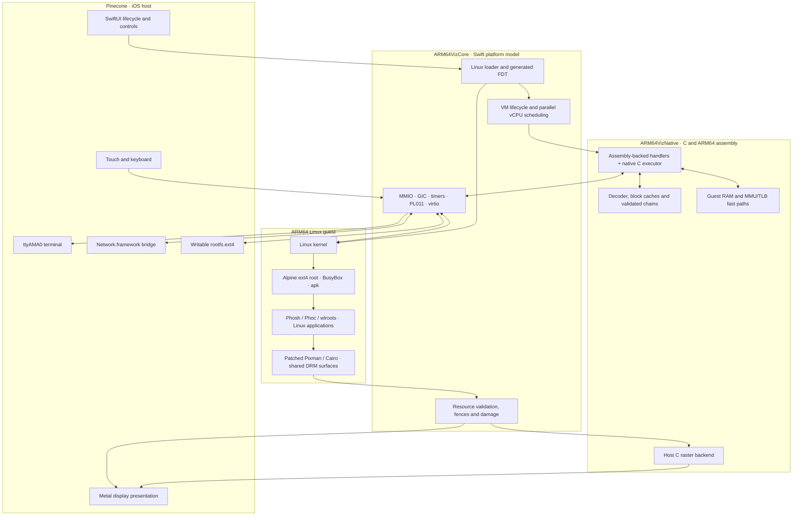

# Pinecone

**A real ARM64 Linux desktop inside an iOS app, powered by our own no-JIT emulator.**

Pinecone boots Linux, mounts a persistent Alpine filesystem, and runs Phosh,
Linux applications, and an interactive Unix shell. The iOS app hosts the VM and
provides display, input, storage, and networking. It is not a Swift recreation
of a Linux desktop.

The underlying engine is **arm64viz**, implemented in C, ARM64 assembly, and
Swift. Guest execution requires neither QEMU nor a hypervisor entitlement.
The former JavaScript MobileOS prototype has been removed.

> **Research software.** Linux and Phosh are functional, but touch latency,
> application startup, rendering correctness, and physical-device memory use
> remain active work. This is not yet a production-ready or near-native desktop.

## Current Capabilities

- Direct ARM64 Linux boot with a generated device tree, GIC, timers, and PL011 console.
- Two parallel vCPUs in the iOS host.
- Persistent ext4 storage through virtio-block.
- BusyBox/Alpine shell utilities, `apk`, and a graphical **Packages** application.
- Phosh with a Home grid, favorites dock, Recent Apps, and All Apps.
- A lightweight guest lock screen with **Tap to unlock**.
- Firefox, NetSurf, Files, Settings, and additional desktop utilities.
- Host-backed TCP/UDP networking and DNS.
- Touch and keyboard forwarding, plus a separate serial terminal.
- Paravirtual 2D graphics with eligible Pixman operations executed by Metal.

The guest is a project-built Linux kernel and customized Alpine userspace, not
an official postmarketOS image. Android, Waydroid, LineageOS, and iOS guests are
not supported boot targets.

## Architecture



### Execution

Pinecone emulates the CPU even when the host is ARM64. Matching instruction
sets do not let a sandboxed iOS app directly execute an entire guest kernel.

The native layer decodes and caches instructions, maintains validated execution
paths, and accelerates memory access where translation and permissions allow it.
Swift owns the surrounding VM, devices, boot, and diagnostic machinery.

| Current default | Physical iOS device | iOS Simulator |
| --- | --- | --- |
| Executor | Assembly-backed handlers plus native C | Same |
| vCPUs | 2, parallel | 2, parallel |
| Guest RAM | 384 MiB | 1024 MiB |
| Legacy Swift instruction fallback | Disabled for normal guest execution | Same |
| Older threaded prototype | Off | Off |
| Assembly service/bounded chaining | Off | Off |
| Hot-PC profiling | Off | Off |

Instructions outside the assembly subset continue through native C, not the
older Swift interpreter. Unsupported native instructions remain implementation
gaps. The desktop CLI retains its established C default unless overridden.

Guest RAM is only part of host memory use: graphics resources, caches, and app
overhead also count toward the iOS process limit.

### Graphics

Patched Pixman, Cairo, and wlroots use registered DRM surfaces and a versioned
Pinecone 2D protocol over virtio-gpu. The host validates resources, tracks fences,
executes eligible batches with Metal, and presents damaged regions.

This is **2D paravirtual acceleration, not a guest OpenGL/Vulkan GPU**.
Unsupported guest operations still execute in Pixman. Host C rasterization is
also available for submitted operations that cannot use Metal. Neither is the
legacy CPU instruction fallback.

Eligible physical-device buffers share backing with Metal. Simulator,
caller-owned, and unsupported buffer paths can still require uploads or copies;
the pipeline is not universally zero-copy.

See [the graphics protocol and ownership model](docs/PINECONE_GRAPHICS.md).

### Virtual Hardware

RAM begins at `0x40000000`. The current guest display is **480 x 1024**, scaled
into the available iOS display area.

| Device | MMIO base | Role |
| --- | --- | --- |
| GICv2 | `0x08000000` | Interrupt distribution and CPU interfaces |
| PL011 | `0x09000000` | Boot output and serial shell |
| virtio-block | `0x0a000000` | Root disk, exposed as `/dev/vda` |
| virtio-net | `0x0a001000` | Host-backed networking |
| virtio-input | `0x0a002000` | Touchscreen |
| virtio-gpu | `0x0a003000` | DRM scanout and Pinecone 2D commands |
| virtio-input | `0x0a004000` | Keyboard |

The Linux adapter stages `Image`, initramfs, and FDT in RAM, passes the FDT
address in `x0`, and enters EL1h. Secondary CPU startup uses PSCI over HVC.

## Quick Start: Core And CLI

Use macOS with Xcode command-line tools and Swift 5.9 or newer. Guest images are
not needed for the core tests or toy UART smoke test.

All commands below run from the repository root unless stated otherwise.

```sh
swift build -c release
swift test -c release
swift run -c release arm64viz run-toy
```

The toy guest exercises the emulator and UART; it is not the Alpine desktop.

```sh
swift run -c release arm64viz --help
swift run -c release arm64viz adapters
```

The CLI also supports Linux handoff preparation, bounded execution traces,
instruction auditing, differential execution, FDT inspection, policy validation,
and diagnostic snapshots. Snapshots are not a complete resumable Phosh boot feature.

## Build And Run The iOS App

### Guest Assets

The checked-in Xcode project expects these generated files:

```text
artifacts/linux-shell/out/Image
artifacts/linux-shell/out/initramfs-minimal-ttyinit.cpio
artifacts/linux-shell/out/rootfs.ext4
artifacts/linux-shell/out/rootfs.ext4.sha256
```

Use a matching kernel, initramfs, rootfs, and checksum from the same prepared
build. A source checkout alone does not include a ready-to-run desktop.
See [Building The Guest](#building-the-guest) to generate the assets.

### Simulator

```sh
xcodebuild \
  -project Apps/iOS/MobileOSHost/MobileOSHost.xcodeproj \
  -scheme MobileOSHost \
  -configuration Release \
  -destination 'generic/platform=iOS Simulator' \
  -derivedDataPath Apps/iOS/MobileOSHost/.DerivedData \
  CODE_SIGNING_ALLOWED=NO build
```

With the desired Simulator booted:

```sh
xcrun simctl install booted \
  Apps/iOS/MobileOSHost/.DerivedData/Build/Products/Release-iphonesimulator/Pinecone.app
xcrun simctl launch booted me.gmoran.pinecone
```

If multiple Simulators are booted, replace `booted` with the device UUID.

### Physical iPhone

Open `Apps/iOS/MobileOSHost/MobileOSHost.xcodeproj` in Xcode. Select your
development team, the **MobileOSHost** scheme, a connected iPhone, and the
**Release** build configuration, then Run.

The app requires iOS 17 or newer and normal Apple developer signing. Its bundle
identifier is `me.gmoran.pinecone`. No prototype launch flags are required.
`MobileOSHost` is the internal project/scheme name, not the removed JavaScript OS.

XcodeGen is needed only when regenerating the project:

```sh
(cd Apps/iOS/MobileOSHost && xcodegen generate --spec project.yml)
```

Recheck signing settings after regeneration.

## Using Pinecone

Linux boots, mounts the persistent root, and reaches its shell. Pinecone then
automatically runs `start-pinecone-phosh` and switches to Display on the Phosh
readiness marker. The default lock screen offers **Tap to unlock**; existing
guest authentication policy still applies.

The right-side slide-out menu contains terminal/display selection, keyboard,
restart, power, and stop controls. The terminal supports scrollback and paste.
Its iOS keyboard is separate from the guest's Wayland on-screen keyboard.

Home, the dock, Recent Apps, All Apps, and the bottom navigation strip are part
of patched Phosh inside Linux, not host overlays. Home icon preloading is
best-effort, not a guarantee of immediate application startup.

To start a graphical session manually from the guest shell:

```sh
start-pinecone-phosh
```

### Networking And Browsers

| Endpoint | Address |
| --- | --- |
| Guest | `10.0.2.15` |
| Gateway | `10.0.2.2` |
| DNS | `10.0.2.3` |

The bridge uses Apple networking for outbound TCP/UDP and DNS. On an iPhone it
follows the host's available Wi-Fi or cellular connection. Guest NetworkManager
exposes virtual Ethernet; it does not control the phone's radios.

`pinecone-network status` reports guest configuration. A successful local ping
does not prove Internet access, and ICMP behavior is not equivalent to a mature
slirp stack. Package downloads and general network performance remain work areas.

Firefox is bundled, with NetSurf as a smaller alternative. Inside the graphical
session:

```sh
pinecone-launch-firefox https://example.com/
pinecone-launch-browser https://example.com/
```

Firefox uses native Wayland and software WebRender, not hardware 3D. It requires
the project's kernel namespace/seccomp support; its integration does not disable
browser sandboxing or site isolation. NetSurf has limited modern-web
compatibility and no renderer sandbox. TLS validation remains enabled.

**The current desktop is a root demo session.** Use trusted test content and
avoid sensitive credentials; this is not a hardened browsing environment.

### Packages

The **Packages** app provides Home, Sources, Updates, Installed, Search,
transaction previews, and activity output backed by real APK metadata.
The command line remains available:

```sh
apk update
apk add tree
apk del tree
```

The `.pinecone-platform` metapackage pins bundled runtime dependencies so package
operations do not silently replace patched libraries. Additional packages can
be managed when their dependencies are compatible. Unrestricted `apk upgrade`
is not the supported way to update the base image.

APK signature checks remain enabled. Platform pins are compatibility constraints,
not a security boundary against guest root. See [Packages](docs/package-manager.md)
and [Firefox integration](docs/firefox-browser-2026-10-28.md).

## Persistence And Updates

The bundled rootfs is copied into Application Support and attached as writable,
file-backed virtio storage. Files and installed packages survive normal VM
restarts. Use the app's stop/reboot controls; force-killing the host is not a
guarantee that all writes have reached durable storage.

**A changed bundled rootfs checksum reseeds the writable disk.** The previous
disk is retained as `rootfs.previous.ext4`, but files and packages are not
automatically migrated. Only one previous disk is kept. Back up important data
before another image update, and do not uninstall the app to preserve its data.

Allow space for the bundled, writable, and previous images. Always bundle the
checksum matching the actual rootfs bytes.

## Building The Guest

Guest builds target Apple Silicon macOS. Beyond Xcode, the scripts use:

- LLVM/Clang, LLD, GNU Make, and libelf.
- Python 3, Meson, Ninja, pkg-config, curl, patch, and archive tools.
- e2fsprogs: `mke2fs`, `e2fsck`, and `dumpe2fs`.
- GLib and shared-mime-info utilities for schema and MIME caches.
- Lima with an Alpine/aarch64 builder and APK build tooling.
- Compatible Cairo/GTK development dependencies inside that builder.

Homebrew tool defaults commonly use `/opt/homebrew`; script headers expose
overrides. Builders modify their dedicated VM's package configuration, so do not
point them at a general-purpose Linux environment.

This is a staged developer build, not a hermetic one-command bootstrap.
Retain selected-package manifests, signed APKs, and public build keys. Rolling
Alpine repositories may no longer serve an older selected version.

### Kernel And Initramfs

```sh
bash scripts/fetch-alpine-aarch64.sh
bash scripts/build-arm64-shell-kernel.sh
```

The second script builds the project kernel and initramfs variants, including
the minimal initramfs bundled by Pinecone.

### Patched Packages

The graphical image requires locally built wlroots, Phoc, Phosh, Settings,
GLib, and musl packages. Use the same dedicated builder:

```sh
export PINECONE_WLROOTS_LIMA_INSTANCE=pinecone-builder
export PINECONE_GLIB_LIMA_INSTANCE=pinecone-builder
export PINECONE_MUSL_LIMA_INSTANCE=pinecone-builder
export PINECONE_SETTINGS_LIMA_INSTANCE=pinecone-builder
export PINECONE_CACHE_LIMA_INSTANCE=pinecone-builder
export PINECONE_CAIRO_LIMA_INSTANCE=pinecone-builder

bash scripts/build-pinecone-wlroots.sh
bash scripts/build-pinecone-phoc.sh
bash scripts/build-pinecone-phosh.sh
bash scripts/build-pinecone-gnome-control-center.sh
bash scripts/build-pinecone-glib.sh
bash scripts/build-pinecone-musl.sh
```

The wlroots builder can create the named Lima VM with the repository mounted;
the others expect it to exist. The current musl overlay is `1.2.6-r10`.
Required runtime revisions and dependency validation are defined in
`scripts/stage-alpine-graphical-rootfs.sh`.

### Root Filesystem

With overlays and build dependencies prepared:

```sh
PINECONE_CACHE_LIMA_INSTANCE=pinecone-builder \
  PINECONE_CAIRO_LIMA_INSTANCE=pinecone-builder \
  bash scripts/build-arm64-rootfs-image.sh
```

This stages Phosh, builds the Pixman bridge and patched Pixman/Cairo, builds
Packages, generates guest caches, registers packages with APK, validates ext4,
and emits the root image and checksum.

Not every helper installs prerequisites automatically. Pixman needs cached ARM64
`musl` and `musl-dev` APKs under `artifacts/alpine-packages/edge-aarch64`.
Cairo needs a compatible development sysroot or builder libraries. Packages
needs `gtk+3.0-dev`, `json-glib-dev`, pkg-config, and a C compiler in the builder.
Resolve missing dependencies rather than disabling verification.

For incremental builds with existing verified library artifacts, add
`PINECONE_REUSE_PIXMAN_LIBRARY=1 PINECONE_REUSE_CAIRO_LIBRARY=1`. Do not reuse
them after changing their source or patches.

For a shell-only image:

```sh
ARM64VIZ_GRAPHICAL_ROOTFS=0 bash scripts/build-arm64-rootfs-image.sh
```

This omits Phosh, so normal graphical autostart cannot succeed. Simulator tests
can override the startup command as described below.

Do not commit `artifacts/` wholesale. It contains downloads, source trees,
packages, build products, and large disk images. Share final assets with their
checksums and build provenance instead.

## Diagnostics And Performance

Capture an unsupported instruction with its opcode, PC, triggering command,
and guest/build configuration. Enabling an unrelated fallback is not a
correctness fix.

Useful Xcode launch environment variables:

| Variable | Purpose |
| --- | --- |
| `PINECONE_VERBOSE_BOOT=1` | Detailed kernel output and early console |
| `PINECONE_ASSEMBLY_EXECUTOR=0` | Compare against the established C executor |
| `PINECONE_GUEST_MEMORY_MB` | Guest RAM override, clamped to 128-1024 MiB |
| `PINECONE_SIMULATOR_AUTORUN_COMMAND` | Replace Phosh autostart in Simulator; use `true` for shell-only work |
| `PINECONE_SIMULATOR_DUMP_UART=1` | Capture guest UART diagnostics |
| `PINECONE_SIMULATOR_WRITE_PERFORMANCE_METRICS=1` | Write structured performance metrics |
| `PINECONE_SIMULATOR_HOT_PC_PROFILE=1` | Enable sampled native PC profiling |
| `PINECONE_SIMULATOR_DUMP_FRAMEBUFFER=1` | Dump framebuffer diagnostics |

Remove stale threaded/chaining overrides before comparing current defaults.
Profiling and competing VMs can materially change results.

Performance work follows [roadmap.md](roadmap.md): measure unlock, input-to-frame,
and cold/warm application launch separately; preserve baseline configuration;
verify pixels, input, and persistence before promoting changes. Instruction
counts and synthetic throughput alone do not establish UI responsiveness.

## Known Limitations

- No JIT, guest hardware virtualization, or guest OpenGL/Vulkan acceleration.
- ARM64 instruction coverage is substantial but not architecturally complete.
- Phosh still has delayed input, choppy transitions, and slow application launches.
- Settings can intermittently render without its title bar.
- Firefox is demanding under interpretation and software rendering.
- Physical-device memory pressure can terminate the host; more guest RAM is not
  automatically an improvement.
- Networking is less complete than mature VM networking implementations.
- No guest audio, camera, telephony, or sensor platform.
- No claim of a hardened multi-user desktop or production mobile OS.

The assembly-backed default is a device-test promotion, not evidence that these
limitations are resolved. See [device-test notes](docs/device-test-promotion.md)
and [graphics profiling findings](docs/phosh-graphics-priority-profile.md).

## Repository Map

```text
Apps/iOS/MobileOSHost/   Pinecone iOS app and Xcode project
Sources/ARM64VizNative/  C/assembly execution, caches, memory and rasterization
Sources/ARM64VizCore/    VM platform, devices, Linux boot and diagnostics
Sources/arm64viz/        macOS CLI
Tests/ARM64VizCoreTests/ Core and regression tests
scripts/                Kernel, guest package, rootfs and validation tooling
scripts/patches/        Linux and userspace integration patches
scripts/rootfs/         Guest services, launchers and Packages source
artifacts/              Generated/downloaded build inputs and outputs
experiments/            Benchmark captures and experimental evidence
ui/                     Browser boot-planning tool, not a guest OS
docs/                   Architecture, protocols and investigation reports
roadmap.md              Active priorities and historical performance phases
```

## Scope And Guardrails

Pinecone is generic ARM64 infrastructure for open-source guest research. It does
not replace iOS, modify the phone's boot chain, or use private hypervisor
entitlements. QEMU is not the execution engine; Lima is a separate guest-build
tool, not part of the iOS runtime.

The proprietary-guest adapter validates metadata only. It does not ingest,
extract, decrypt, or boot IPSWs or other proprietary OS packages. The project
does not supply proprietary firmware, boot ROMs, device keys, activation
materials, attestation bypasses, or service impersonation.

`arm64viz.preferences.json` may add restrictions; it cannot remove built-in
guardrails. See [guest boundaries](docs/proprietary-guest-boundaries.md).

## Further Reading

- [Active performance roadmap](roadmap.md)
- [iOS host and installation notes](Apps/iOS/MobileOSHost/README.md)
- [VM architecture](docs/architecture.md)
- [Paravirtual graphics](docs/PINECONE_GRAPHICS.md)
- [Guest package manager](docs/package-manager.md)
- [Firefox integration](docs/firefox-browser-2026-10-28.md)
- [Lightweight lock screen](docs/lightweight-lockscreen-2026-10-28.md)
