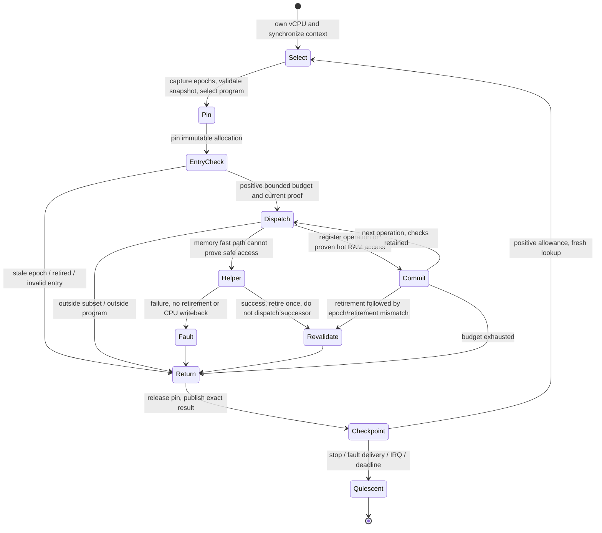

# Phase 2: Native Execution and Invalidation Contract

Date: 2026-10-29. Scope: Pinecone's full-system ARM64 interpreter.

This is the design contract for the next executor experiment, not an assertion
that a longer production execution window is already safe. The established C
executor and threaded C prototype both remain. Runtime selections, invocation
caps, validation, memory helpers and scheduling defaults are unchanged.

The [Phase 1 cohort](phase1-clean-cohort-results.md) identifies repeated short
invocations as the first measured optimization target. It does not establish
that removing validation or increasing a production cap is correct. Phase 3
remains an opt-in register-only assembly experiment; this contract also governs
any later improvement to the existing C threaded path.

## 1. Architectural State and Ownership

| ID | Required invariant |
| --- | --- |
| E1 | One host execution owner per guest vCPU. That owner exclusively mutates its CPU, decoded cache and fast-memory context. A second vCPU owns separate instances. |
| E2 | Guest registers, vectors, SP, PC, PSTATE, FPCR/FPSR, exclusive-monitor fields and halt state are architectural at every externally visible exit. Do not confuse guest SP/flags with host SP/flags. |
| E3 | `result.steps` counts successfully retired guest instructions, not handler entries, attempted faulting instructions, blocks or host polls. A callback is never replayed merely because execution exited. |
| E4 | An immutable decoded allocation remains alive through every active invocation. Validity and allocation lifetime are separate proofs. |
| E5 | RAM, CPU, fast-memory context, cache and epoch-token storage outlive the invocation and its callbacks. A code-generation match is not a RAM ownership reference. |
| E6 | Cache destruction, RAM replacement and VM teardown wait for vCPU quiescence and outstanding device/graphics users. Peer invalidation never directly frees another vCPU's private cache. |

The current C path commits state through `AVZNativeCPU` after each instruction.
Its helpers receive the faulting instruction's PC before retirement; successful
loads/stores commit writeback and the next PC only after the helper succeeds.
Guest vectors and FP state remain untouched by the current scalar subset.

Caching guest state in host registers is a future optimization. Such state must
be materialized before calling a helper that can inspect it, on every side exit,
and before publishing quiescence. Fault reconstruction may not guess the PC
from a nominal block length or count a fused sequence as one guest instruction.

The Swift checkpoint currently accounts a translation-fault attempt as an extra
backend step. That existing telemetry convention is not the native retirement
contract. Compare native retirement separately; do not silently change badge
semantics while benchmarking an executor.

## 2. Entry, Dispatch and Exit State Machine

The diagram describes execution inside the native chain plus its host boundary;
the standalone `avz_tp_run*` APIs do not implement host checkpoints themselves.
Null/disabled/zero-budget entry can return before allocation pinning.

Current enabled `avz_tp_run_guarded` entry precedence is:

1. Null CPU/program: `INVALID_ARGUMENT`, no effects.
2. Zero budget: `MAX_STEPS`, no effects, even if halted or epochs are stale.
3. Halted CPU: `HALTED`, no effects.
4. Pin allocation and validate captured epochs: mismatch is `REVALIDATE`, zero steps.
5. Resolve the exact aligned PC in this snapshot, or return `OUTSIDE_BLOCK`.

Disabled builds return `DISABLED` without execution. The native chain API has
its own argument validation: zero initial allowance/step/block budget or zero
checkpoint interval is invalid there, not a standalone no-op run.

| Exit | PC and retirement | Required consumer behavior |
| --- | --- | --- |
| `MAX_STEPS` | Next architectural PC; exactly the retired prefix | Service due events; never continue on a spent allowance. |
| `OUTSIDE_BLOCK` | Branch/fall-through target, or unchanged out-of-range entry PC | Fresh context-aware selection; no instruction is lost. |
| `UNSUPPORTED` | First unexecuted instruction, raw opcode, completed prefix only | A supported established C handler may execute it once. This is not a memory-fault retry route or permission to use Swift fallback. |
| `REVALIDATE` before dispatch | Original CPU and zero steps | Synchronize and reselect; do not reuse the rejected pointer. |
| `REVALIDATE` after success | Next PC and completed instruction included | Process checkpoint and revalidate code/mappings before another instruction. |
| `MEMORY_FAULT` | Faulting PC, prior retired prefix, no faulting-instruction CPU writeback | Deliver the recorded fault/blocked-access outcome; never rerun the access as unsupported. |
| `HALTED` | Architectural halt state | Return to host; no busy retry. |
| Chain `YIELDED` | State after the last completed instruction | Host handles IRQ/deadline; polling does not acknowledge an IRQ. |

For a successful hot operation, current `TP_NEXT` commits retirement, checks
validity, then checks budget. Revalidation therefore wins over exhausted budget.
A successful full memory helper always returns `REVALIDATE`, including when it
uses the last permitted instruction. Failure wins without retirement, even if
the callback also invalidated code. Helper-owned effects, including device
writes, fault records and dirty/observation notifications, are not rolled back.

The chain converts `REVALIDATE` to its normal lookup exit and forces a checkpoint.
A due native IRQ can produce `YIELDED`, but cannot replace `HALTED`,
`UNSUPPORTED` or `MEMORY_FAULT`. Host stop/preemption is checked before Swift
fault handling today. Any new executor must preserve the recorded fault through
that interaction; a simultaneous stop is not evidence that a fault disappeared.

## 3. Host ABI

### Current C Contract

`TPHandler` has one uniform C signature, `(TPExecution *, const TPOperation *)`.
Compiler-enforced `musttail` is required; an ordinary recursive call is not an
acceptable substitute. The compiler owns host register allocation and ABI
preservation. No fixed physical register carries guest state across C calls.
The existing API returns `AVZNativeBlockResult` through the compiler's C ABI;
assembly must not assume that this aggregate fits return registers.

Helpers may clobber ABI-volatile registers and flags. All helper-visible guest
state remains in memory. No Objective-C/C++ exception, `longjmp`, or cancellation
unwind may cross a pinned executor invocation: normal return is required to
release its pin. Faults use explicit result channels, not host exceptions.

### Phase 3 Private Gadget ABI

Implementation follow-up: this convention is now exercised in the isolated
[Phase 3 experiment](phase3-gadget-results.md), not the shipping VM. Its result
report distinguishes tested caller preservation from remaining integration and
live-unwind gates.

Use a compiler-called entry veneer with pointer arguments and a caller-owned
result/control record, not the existing aggregate-return convention. Generate
and statically verify offsets from the C declarations; do not hand-maintain a
second `AVZNativeCPU` layout in assembly.

| Host register | Initial private role |
| --- | --- |
| `x19` | CPU pointer |
| `x20` | Current decoded operation pointer |
| `x21` | Remaining instruction allowance |
| `x22` | Retired instruction count |
| `x23` | Run/control record, including validity tokens and result pointer |
| `x24`-`x28` | Unallocated; no implicit guest-state cache |
| `x0`-`x17`, NZCV | Temporary/call scratch, never live across a helper |
| `x18` | Untouched platform-reserved register |
| `x29`, `x30`, SP | Host frame, return linkage and aligned stack, never guest storage |

The entry/exit veneer saves/restores every used callee-preserved register,
maintains 16-byte stack alignment and valid frame/unwind metadata, and restores
host state on every exit. The first subset does not cache guest vectors or change
host FPCR/FPSR. Later vector handlers must preserve ABI-required vector state;
in particular, preservation of the low halves of v8-v15 is not preservation of
entire guest vectors. Follow [Apple's ARM64 ABI](https://developer.apple.com/documentation/xcode/writing-arm64-code-for-apple-platforms)
and [AAPCS64](https://github.com/ARM-software/abi-aa/blob/main/aapcs64/aapcs64.rst).

Before any helper: materialize PC/state, spill scratch, call through an ordinary
C-compatible veneer, and terminate or revalidate as required above. First-phase
gadget helpers are terminal, not a new continuation optimization. Never use guest
addresses as host code pointers. Only precompiled handler targets are executable.
Host arm64e pointer authentication/unwind support requires a separately verified
veneer; unverified targets keep the C path. No runtime code generation is added.

## 4. Validity, Publication and Reclamation

| Proof | Owner and current observation | What it does not prove |
| --- | --- | --- |
| Local cache mutation epoch | vCPU owner; checked at entry and after each retired threaded instruction | Safety of peer writes to private cache fields |
| Shared code epoch | Shared atomic publication; acquire loads in threaded guards | RAM lifetime or completion of a peer's in-flight instruction |
| Shared translation epoch | Publisher lock plus release publication; reader compares and catches up under the same lock | Automatic invalidation of every private TLB at publication time |
| Program `active_runs`/`retired` | vCPU-confined pin; final return frees retired allocation | Cross-host-thread cache destruction safety |
| Direct successor/serial | Owner validates identity/context before reuse | A permanently valid raw successor pointer |

Acquire code/translation snapshots before selecting and validating a program,
then recheck them after pinning and before dispatch. Check the complete execution
context, not just virtual PC: EL, translation controls, ASID/address-space
identity, permissions and executable-page identity must remain applicable.
`avz_tp_run_with_memory` captures epochs at entry; it cannot prove that arbitrary
caller-prepared code was valid before that capture. Its stable-code precondition
remains. Runtime cache selection must supply the earlier validation proof.

Current callback-safe reclamation is intentionally local: cache clear/eviction
can retire the active immutable program; its pin delays freeing the operations
until return. The callback may not replace/free CPU, RAM, cache, fast-memory
context or token storage. A peer publishes invalidations through shared memory;
the owner catches up and invalidates its own cache.

Shared TLBI uses a 64-entry journal. Writers serialize the journal update and
release-publish its epoch. A reader locks while collecting entries, applies
local invalidations, then advances its observed epoch. Falling behind the
journal requires a full invalidation, not skipping lost entries. Publication
orders prior protected writes; it is not itself an acknowledgement by readers.

Executable writes must retain existing code-page/dirty/observer notification and
memory synchronization. The next dispatch guard detects changed generations;
an instruction already in flight is not magically revoked. Likewise, TLBI
publication is not a proof of architectural barrier completion. A longer executor
must not cross guest synchronization instructions using a stale proof: those
instructions remain outside the initial subset and return through authoritative
handlers. Select/validate/pin races during newly discovered executable pages,
barrier acknowledgement and shared RAM lifetime require explicit tests before
amortizing validation or allowing cross-program continuation.

Finite-generation wrap or allocation/address reuse must not create ABA matches.
Before any reset capable of reusing identities, quiesce affected vCPUs, invalidate
all dependent code/TLB/direct-link proofs and retain backing memory until readers
and devices release it. Current journal overflow tests are not a proof of epoch
wrap safety. Wrap/reclamation remain promotion gates for new lifetime protocols.

## 5. Polling and Budget Contract

There are three independent limits: retired instructions, completed native/block
boundaries, and elapsed host time. `AVZ_TP_MAX_INSTRUCTIONS == 4096` is snapshot
capacity, not an approved runtime quantum. A small self-loop can run far longer
than its decoded length if the caller gives it a larger allowance.

Current behavior:

- Runtime prototype calls are capped at decoded block length, at most 16
  instructions, and at the chain's remaining checkpoint/global allowance.
- Validity is checked at entry and after each successful hot instruction.
- Native timer/IRQ processing occurs at executor returns. Host-clock-backed
  counter refresh uses a 1024-retirement threshold at those boundaries; it is
  not a hard 1024-instruction bound because a return can cross the threshold.
- Host checkpoints also use a configured block interval. Prototype invocations
  currently contribute one block, while superblocks report mapped blocks.
- Swift checks stop and host-preemption generation at checkpoints. Its wall
  deadline check is gated by a 4096-accounted-step threshold; checkpoints can
  overshoot that threshold. The next returned instruction allowance is at most
  65536, additionally constrained by the caller's timer budget where applicable.

Required behavior for any longer-window implementation:

1. Keep per-instruction validity guards initially. Do not combine removal of
   those checks with the first continuation or gadget change.
2. Clamp the window to the minimum of global remaining steps, host checkpoint
   allowance, applicable timer deadline and next native event-service boundary.
   Use saturating/checked arithmetic; zero means exit, never an unlimited run.
3. Service native timer/IRQ state no less frequently than the current block
   boundary schedule. Preserve block-based host checkpoints or service them
   earlier. Repeated loop visits cannot be hidden inside a single counted block.
   If the new path cannot represent these limits, retain the current short cap.
4. A host checkpoint returning zero terminates the invocation immediately.
   A later run gets a fresh allowance; the zero return is not a sticky halt.
5. Successful full helpers, faulting helpers, synchronization/system instructions
   and context changes remain terminal boundaries. No callback can be replayed
   or followed through a pre-callback successor pointer.
6. The first multi-operation experiment stays within one pinned immutable
   program. Cross-program chaining requires separate acquisition, pinning,
   context/epoch validation and reclamation tests before use.

The maximum permitted *additional* event-service delay from an optimization is
zero relative to the current step/block service schedule. This is not a promise
of zero wall-clock input latency. A blocking helper, descheduled host thread or
guest application can still delay progress. No new millisecond guarantee is
claimed: measure publication-to-checkpoint and input-to-frame latency separately
under the same two-vCPU Simulator workload before promotion. Timer checks alone
cannot establish touch responsiveness.

## 6. Review and Promotion Decisions

Source review covered `TP_NEXT`, guarded entry and memory handlers, cache program
ownership, native chain checkpoint/IRQ ordering, shared TLBI catch-up and Swift
host-preemption/accounting. The [test matrix](phase2-test-matrix.md) distinguishes
executable checks from future gates. This is a source/test review, not independent
certification of the ARM memory model or a new assembly ABI implementation.

Decisions for the next change:

- Retain both established C and threaded C. No default change or Swift fallback.
- Keep memory, device and fault semantics in the existing authoritative helpers.
- Start the assembly experiment with the register subset and precise side exits.
- Keep generation guards; do not promote Phase 1's no-check timing controls.
- A faster synthetic cap is evidence for a hypothesis, not permission to widen
  production slices. Event-bound, ABI, reclamation and full-system gates remain.

Only a later implementation with passing differential/ABI/adversarial tests and
repeatable workload improvement may become the default. That promotion includes
boot, tap-to-unlock, Settings and browser event handling with zero Swift fallback;
it must not substitute an instruction-count decrease for measured responsiveness.
